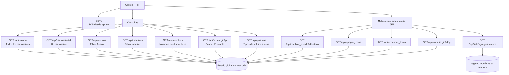

# super-happiness28092026
Clase de Programación de redes sobre Git

## Proyecto Flask

La aplicación de inventario de dispositivos está en `PdR/app.py`. Mantiene diez dispositivos y una lista de nombres en memoria, y expone los endpoints descritos abajo. Las respuestas de la API son JSON. Flask asigna `GET` como método predeterminado a todas las rutas actuales.

### Ramas

En la inspección del repositorio remoto del 28-09-2026 se encontraron estas ramas: `main`, `feature`, `feature02`, `feature03`, `release`, `release02` y `release03`. Todas apuntaban al mismo commit inicial (`1f9393b5e4866b57486217a63c81973950835305`), por lo que en ese momento no había diferencias de contenido entre ellas. La documentación y el código de este cambio se publican en `feature`.

### Ejecución

Dependencias listadas en `PdR/req.txt`. La aplicación se diseñó para arrancar desde el directorio `PdR` con:

```powershell
cd PdR
python app.py
```

**Bloqueo actual de arranque:** antes de crear Flask, `app.py` abre `API.json` con `encoding="uft-8"`. El archivo del proyecto se llama `api.json` y la etiqueta de codificación correcta es `utf-8`. Corrige ambos valores (incluyendo las mayúsculas/minúsculas para sistemas sensibles a ellas) antes de ejecutar la aplicación.

### Rutas

| Método | URL | Qué hace | Respuesta y casos límite |
|---|---|---|---|
| GET | `/` | Imprime `Cambio` en la consola y devuelve el contenido cargado de `api.json` (`datos_json`). | El JSON estático del archivo. |
| GET | `/api/saludo` | Devuelve todos los dispositivos. | Objeto JSON indexado por ID. |
| GET | `/api/dispositivo/<int:id_disp>` | Busca un dispositivo por ID entero. | Dispositivo JSON; si no existe, `404` con `{"error":"Dispositivo no encontrado"}`. |
| GET | `/api/activos` | Filtra dispositivos cuyo `status` es `Activo`. | Objeto JSON indexado por ID; puede ser vacío. |
| GET | `/api/inactivos` | Filtra dispositivos cuyo `status` es `Inactivo`. | Objeto JSON indexado por ID; puede ser vacío. |
| GET | `/api/nombres` | Recopila los nombres de todos los dispositivos. | `{"nombres_dispositivos":[...]}`; conserva duplicados. |
| GET | `/api/buscar_ip/<ip_buscada>` | Busca una coincidencia exacta de IP. | Objeto con ID y dispositivo; si no coincide, `{"mensaje":"IP no encontrada"}` (HTTP 200). |
| GET | `/api/cambiar_estado/<int:id_disp>/<nuevo_estado>` | Cambia el `status` del dispositivo indicado. | Mensaje y dispositivo actualizado; para ID inexistente devuelve error JSON (HTTP 200). No valida los valores de estado. |
| GET | `/api/apagar_todos` | Cambia todos los estados a `Inactivo`. | Mensaje y diccionario completo actualizado. |
| GET | `/api/encender_todos` | Cambia todos los estados a `Activo`. | Mensaje y diccionario completo actualizado. |
| GET | `/api/politicas` | Obtiene los tipos de política sin repetirlos. | `{"tipos_de_politicas":[...]}`, en orden de primera aparición. |
| GET | `/api/cambiar_ip/<int:id_disp>/<nueva_ip>` | Cambia la IP del dispositivo indicado. | Mensaje y dispositivo actualizado; para ID inexistente devuelve error JSON (HTTP 200). |
| GET | `/api/lista/agregar/<nuevo_nombre>` | Añade un elemento a `registro_nombres`. | Mensaje y lista actualizada. Esta lista no es la lista de nombres calculada desde los dispositivos. |

Los segmentos entre `<...>` son parámetros de ruta. `<int:id_disp>` solo acepta enteros; las IP y los textos se pasan como segmentos de URL, codificando caracteres reservados cuando corresponda.

### Mapa visual de rutas



### Comportamiento a tener en cuenta

- Las operaciones de cambio de estado, IP y lista usan `GET`. Para una API real, deben migrarse a métodos de escritura como `PATCH` o `POST` para evitar mutaciones accidentales por clientes, precarga o caché.
- `dispositivos` y `registro_nombres` son variables globales en memoria; los cambios no son persistentes y se pierden al reiniciar el proceso.
- El punto de entrada `/` devuelve el JSON de `api.json`, mientras que `/api/saludo` devuelve el inventario de dispositivos.
- Los errores de ID inexistente no son uniformes: `/api/dispositivo/<id>` usa HTTP 404, pero las rutas de cambio de estado/IP devuelven HTTP 200.
